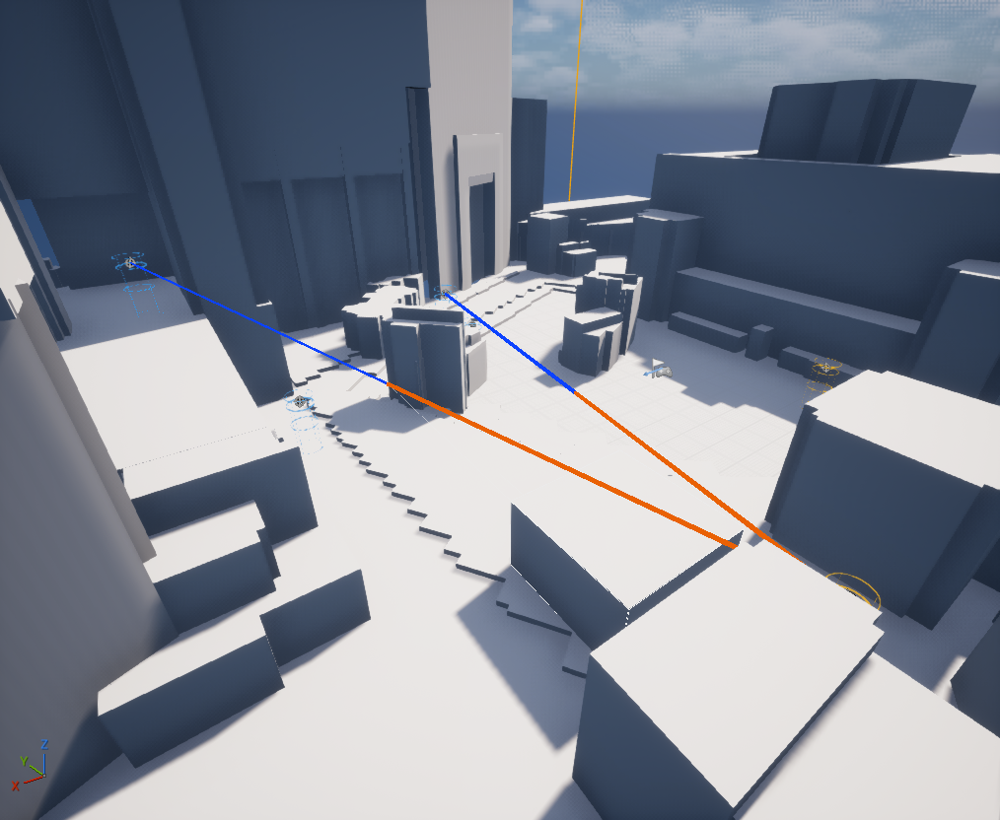
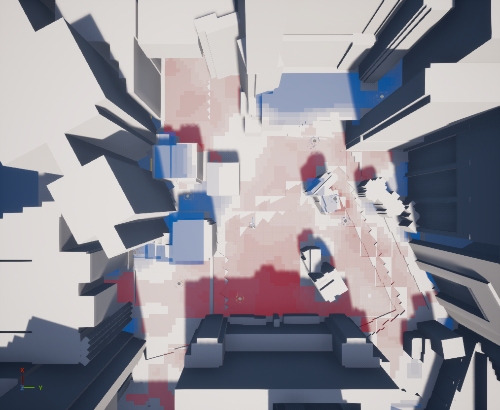
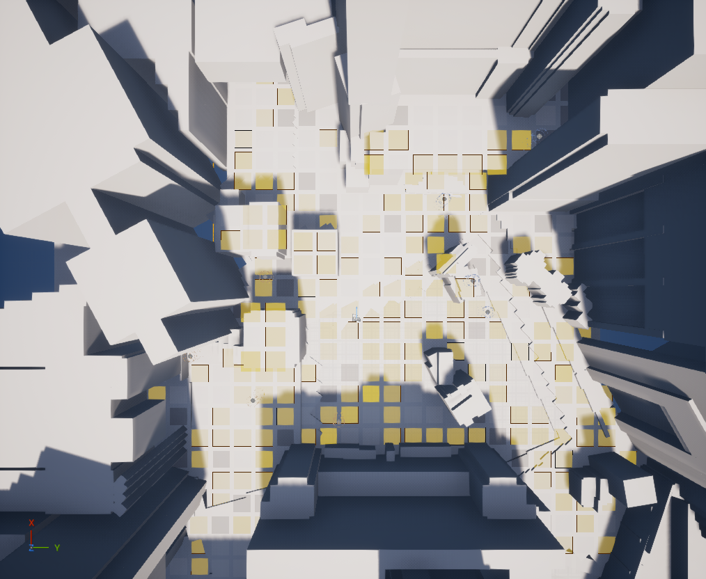
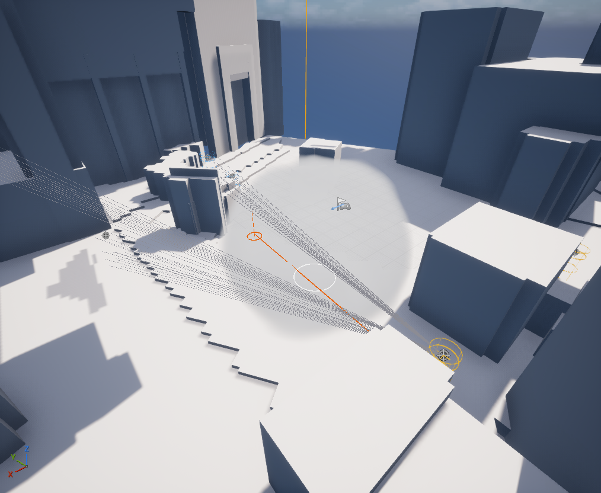

# Exposure Probe

English | [中文](README.zh-CN.md)

Exposure Probe is an Unreal Engine 5.8 editor plugin for checking sightlines in competitive shooter levels. You place T and CT probes in a level. From each probe's eye, the plugin casts rays to sample points on the other side's bodies and reports how much of the other body each side can see. The difference between the two shares is the exposure asymmetry A. After each edit it recasts only the rays the edit can affect, then lists the probe pairs that changed, including any pair that became one-way.

It also has a floor heatmap with one-way cells, smoke evaluation (the fewest smokes that cut a sightline, and how soon the observer can see again), and version baselines with regression reports.



## Requirements

Unreal Engine 5.8 on Windows 64-bit. The prebuilt binaries were built and tested on 5.8.3 and need no Visual Studio, so they work in Blueprint and C++ projects alike. The plugin runs in the editor only. Probes and smokes are editor-only actors and are left out of packaged games.

## Install

Download `ExposureProbe-0.3.0-UE5.8.zip` from [Releases](https://github.com/CAI-IP/ExposureProbe/releases). Cloning the repository gives you the source without the prebuilt binaries (see [Building from source](#building-from-source)).

Close the editor and copy the `Plugins` folder from the archive into your project root, next to the `.uproject` file:

```
<YourProject>/
  <YourProject>.uproject
  Plugins/
    ExposureProbe/
      ExposureProbe.uplugin
    ExposureProbeMCP/          (optional)
```

If the project already has a `Plugins` folder, put the two subfolders inside it. Open the project and an **Exposure Probe** button appears on the level editor toolbar. If it doesn't, enable the plugin under **Edit → Plugins** and restart the editor.

## Quick start

This works in any level. No sample map is needed.

1. Open **Project Settings → Plugins → Exposure Probe** and set **Unit Preset** to your level's scale. The default is CS2 / Source (1 unit = 2.54 cm, a 72-unit player). For a level built in UE centimetres, pick **UE First Person Template** or **Adult 180 cm**, or the probe bodies end up 72 cm tall.
2. Point the viewport centre at the floor and choose **Exposure Probe → Place T Probe** on the toolbar, then **Place CT Probe** somewhere else. The **Exposure Probe** category in **Place Actors** has them too. Probes drop to the floor below them when the plugin computes.
3. Open the panel with **Exposure Probe → Open the Exposure Probe Panel** and press **Recompute**. Each probe pair gets a link in the viewport, the seen head, torso and legs are filled by visible share, and a card shows the values.
4. Move a wall or drop in a crate. About 0.4 s after you release the mouse, the plugin updates and shows "This edit affects N probe pairs; M with new one-way sightlines". The panel lists the changed pairs and the rays that flipped.
5. Turn on the **Heatmap (full-map A)** or **One-way sightlines** layer in the toolbar menu. The first time, the plugin analyses the floor, which takes longer on large levels or with a small sample spacing.

Everything else lives in the toolbar menu, the panel (also under **Window**) and the plugin settings. The interface follows the editor language. To force Chinese or English, set **Display → Language** and restart the editor.

## How it measures

Each probe body has 16 sample points, 4 heights by 4 bearings, near the feet, knees, waist and head. A point is visible when the ray from the observer's eye reaches it, or when the first hit is within 1 cm of it. a(T→CT) is the share of CT's points that T can see. Points buried in a wall are left out of the count; a point is buried when a ray from the body axis at the same height is blocked before reaching it.

A = a(T→CT) − a(CT→T), between −1 and 1. A positive value means T sees more of CT than CT sees of T.

A pair is one-way when one side sees at least 50% of the other's points and the other side sees none. The threshold is **Audit → One Way Threshold**.

With the pose on **Auto**, the plugin checks the head clearance above each probe. The probe stands where there is room, crouches where there is only room to crouch, and is skipped otherwise, with a note in the panel.

Some one-way sightlines are on purpose. **Mark as Design Intent** on a pair stores a note with the level, and later reports list those pairs separately as expected changes.

## Unit and body presets

**Unit Preset** sets the map unit and the player body together. Editing any body dimension switches it to **Custom**. A single probe can use another body through **Body Preset** in its details panel, which helps when comparing body types.

| Preset | 1 unit | Height | Standing eye | Crouch height | Crouching eye | Width |
|---|---|---|---|---|---|---|
| CS2 / Source | 2.54 cm | 72 | 64 | 54 | 46 | 32 |
| Call of Duty | 2.54 cm | 72 | 60 | 52 | 40 | 32 |
| Valorant | 1 cm | 180 | 166 | 140 | 126 | 68 |
| UE First Person Template | 1 cm | 192 | 160 | 80 | 72 | 68 |
| Adult 180 cm | 1 cm | 180 | 167 | 135 | 120 | 80 |

Sizes are in map units. CS2 uses the player hull from Valve's developer documentation and Call of Duty the Radiant level design standards. Valorant has no published figures, so its row is a community estimate. The UE First Person Template row comes from the template character's capsule and eye height.

Sampling defaults to 16 points (4 × 4). You can switch to 64 points (8 × 8) or set your own layer heights and bearings; computing time grows with the point count.

## Floor analysis

**Analyse Floor** samples the standable floor on a grid, 64 units apart by default, and treats every sample as a player. The heatmap shows each spot's A: how much it sees of the other samples within 1000 units, minus how much they see of it. Spots that cannot see each other at all are left out. Blue sees more than it is seen, red the reverse.

The one-way layer marks in yellow the cells that see spots which cannot see them back. With probes selected, it shows their relation to those probes instead: yellow cells see the selection one-way and dark cells are seen one-way by it. With a baseline that holds a floor analysis, the heatmap can also show ΔA against that baseline.

When the level has a navigation mesh, only floor on the mesh that can be walked to or jumped onto from a probe or player start is sampled. **Heatmap Max Climb** defaults to about 0.89 of the player height. Without a navigation mesh, every standable surface is analysed, including tops nobody can reach, and the panel says so.




## Smoke

A smoke is a sphere whose centre sits above the landing point. The radius and duration come from the chosen game:

| Size preset | Radius | Centre height | Duration |
|---|---|---|---|
| CS2 smoke grenade | 144 units (365.8 cm) | 60 units | 22.06 s |
| Valorant Brimstone | 410 cm | 171 cm | 19.25 s |
| Valorant Omen | 400 cm | 167 cm | 15 s |
| Valorant Astra | 475 cm | 198 cm | 14.25 s |

Valorant publishes no centre height, so those rows use the CS2 ratio (60 / 144).

**Place Smoke** in the toolbar menu or the panel puts a smoke at the point under the viewport centre. You can also drag **Smoke** from Place Actors. After a floor analysis, smokes snap to the nearest floor cell, and again after a drag or an Alt-drag copy. The **Size** of each smoke in its details panel is **Shared** (the size in the plugin settings), a game preset or a custom size.

Placed smoke blocks the probe rays. With a probe selected, drag a smoke and the links, body fills and A follow it. On release, the edit report counts the smoke as a level edit. The floor layers always use the static geometry.

With a probe selected, **Evaluate Placed Smoke** shows how much of its sightlines to the other side the placed smoke cuts, what each smoke adds, and RT. **Compute Smoke Plan (CC / RT)** searches the analysed floor cells for the fewest smokes that cut 80% of the probe's visible sightlines; that number is CC. If **Smoke Max Count** (5 by default) is not enough, CC is reported as above the limit. **Convert Plan to Placed Smoke** turns the plan into smoke actors you can drag and resize.

RT is the recovery time. The observer either waits for the smoke to clear or walks to a nearby spot that sees again, whichever is quicker. The walk takes the nav path length ÷ the move speed (113 units/s by default), plus 0.5 s to aim again. Detour spots are floor cells within 2000 units of the observer that still see 80% of the original sightlines past the smoke, with an A no more than 0.05 below the observer's spot. Without a navigation mesh the detour is a straight line. Without a floor analysis no detour is searched and RT is the smoke duration. If the placed smoke cuts 20% of the sightlines or less, the observer still sees the target and RT is 0.

**Style** in the panel (**Smoke Style** in the plugin settings) changes only the look. **Volume**, the default, is a ray-marched volume cut off at walls and floors. Its material compiles on first use, and puffs show until it is ready. **Puffs** are clusters of translucent spheres and run lighter on slower machines.



## Baselines and reports

Type a version name such as "Playtest 3" in the panel's baseline bar and press **Save Baseline**. The baseline stores the probes, settings, a geometry fingerprint and the results, plus the floor analysis when it is up to date. Each level save also stores a "Last save" baseline and renames the previous one to "Save before last". **Audit → Baseline On Save** turns this off.

Pick a baseline from the drop-down to see the pairs that changed against it and the one-way pairs that appeared or went away. When the inputs match the baseline exactly, the panel also says whether the results reproduce.

**Export Report** writes the changes against the active baseline, or against the last edit when none is active, as a Markdown file and a JSON file. Pairs with |ΔA| of 0.05 or more count as clear changes. Pairs further than **Far Distance** from the edit are listed separately and drawn in the viewport with dashed connectors from the edit.

Everything is written to `Saved/ExposureProbe/` in the project: `audit_log.jsonl` with one line per update or design-intent change, `last_report.json` for the latest update, and the `Baselines/` and `Reports/` folders. **Open the Log, Baseline and Report Folder** in the toolbar menu opens it.

## MCP tools (optional)

`ExposureProbeMCP` lets an AI assistant or a script call the plugin through the Model Context Protocol. Leave the folder out if you don't need it.

Enable **Unreal MCP** (experimental) and **Exposure Probe MCP Tools** under **Edit → Plugins** and restart the editor; Toolset Registry is enabled with them. Then type `ModelContextProtocol.StartServer` in the editor console. The server listens on `http://localhost:8000/mcp`. The toolset is `ExposureProbeMCP.ExposureProbeToolset`, parameter names are camelCase (for example `probesJson`) and positions are in centimetres.

| Tools | Purpose |
|---|---|
| `SpawnProbes`, `ClearProbes`, `GetProbes` | Place, delete and list probes |
| `FullRecompute`, `UpdateNow`, `GetLastReport`, `GetRays` | Full cast, local update, report and rays |
| `MarkDesignIntent`, `ClearDesignIntent` | Design intent marks |
| `SetDrawMode`, `SetView`, `SetFloorFilter`, `SetAutoUpdate` | Viewport drawing and automatic updates |
| `GetSettings`, `SetSettings` | Read and change plugin settings (not written to the config file) |
| `ComputeHeatmap`, `GetHeatmap`, `GetOneWay` | Floor analysis |
| `SaveBaseline`, `SetBaseline`, `ListBaselines`, `ExportReport` | Baselines and reports |
| `ComputeSmoke`, `GetSmoke`, `ClearSmoke`, `PlacePlanSmokes` | Smoke plans |
| `PlaceSmokes`, `GetPlacedSmokes`, `MoveSmoke`, `ClearPlacedSmokes`, `EvaluateSmokes` | Placed smoke |

Each tool returns a JSON string. Parameter formats are in the comments of `Plugins/ExposureProbeMCP/Source/ExposureProbeMCP/Public/ExposureProbeToolset.h`.

## Building from source

Build from source for an engine version other than 5.8, when the editor reports missing or mismatched modules, or when you change the code. You need Visual Studio 2022 or later with the **Game development with C++** workload, and a C++ project. A Blueprint project becomes one once you add any class through **Tools → New C++ Class**. Delete `Plugins/ExposureProbe/Binaries` (and `Plugins/ExposureProbeMCP/Binaries` if you use it), then build the project's editor target, or open the `.uproject` and answer **Yes** to the rebuild prompt.

## Troubleshooting

**The editor says modules are missing or built with a different engine version.**
The prebuilt binaries are for UE 5.8 on Windows 64-bit only. Build from source for anything else.

**There is no Exposure Probe button on the toolbar.**
`ExposureProbe.uplugin` must sit directly in `<Project>/Plugins/ExposureProbe/`, with no extra folder level, and the plugin must be ticked under **Edit → Plugins**.

**Probes look far too big or far too small.**
The unit preset doesn't match the level. A CS2 / Source player is 72 units tall, so a level built in UE centimetres needs **UE First Person Template** or **Adult 180 cm**.

**The panel says a probe was skipped.**
There isn't room above it to crouch. Move it somewhere more open or change the body size.

**The heatmap covers rooftops nobody can reach.**
The level has no navigation mesh, or **Heatmap Reachable Only** is off. Add a Nav Mesh Bounds Volume, build navigation and analyse the floor again.

**Volume smoke shows up as small balls at first.**
The material is still compiling and switches over by itself. If compiling fails, the log says `Volume smoke material failed to compile` and smoke stays as puffs. Results are not affected.

**Nothing updates after an edit.**
Check **Auto** in the panel and **Audit → Auto Update** in the plugin settings. **Update** in the panel runs an update at any time.

## Licence

MIT, see [LICENSE](LICENSE). By CAI IPHONG. Report problems and suggestions in [Issues](https://github.com/CAI-IP/ExposureProbe/issues).
