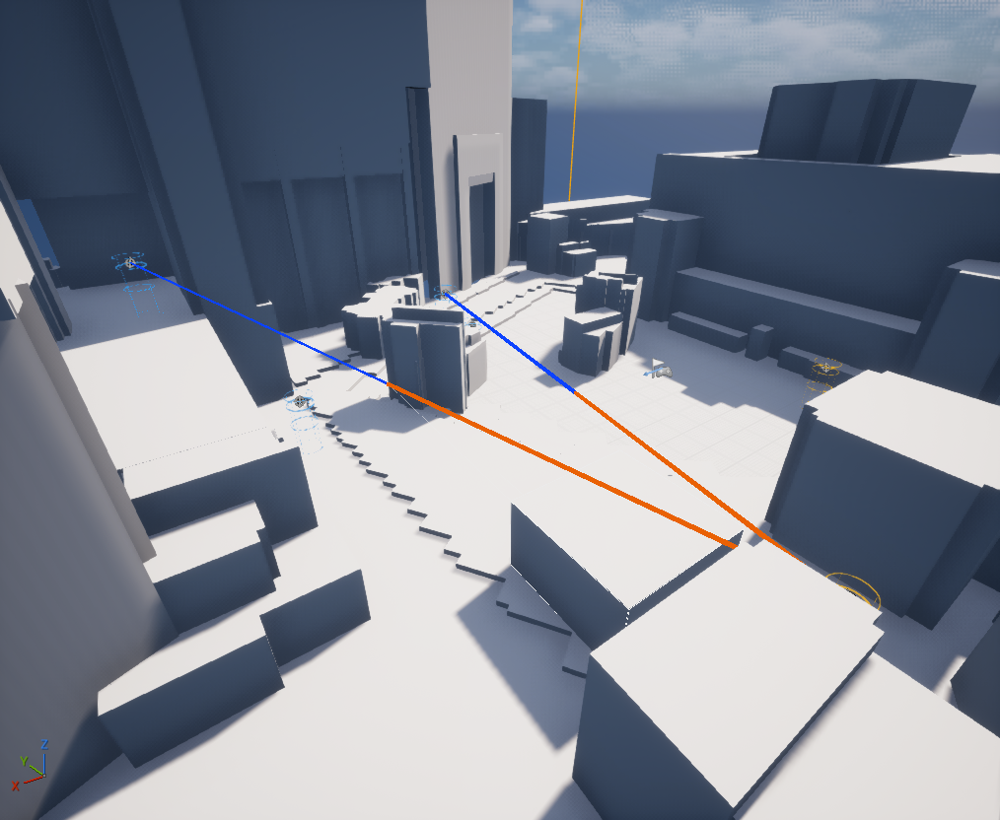
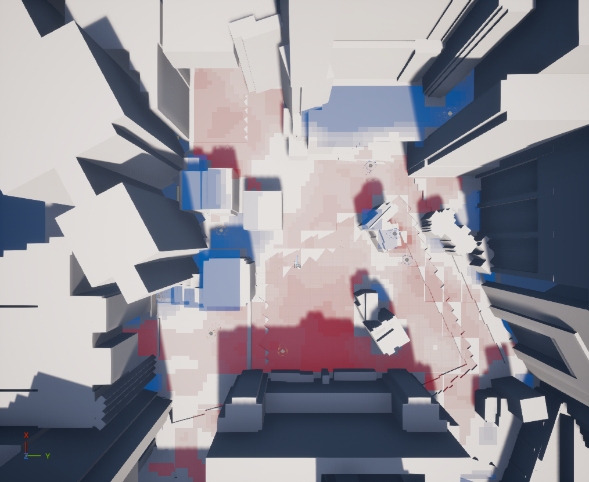
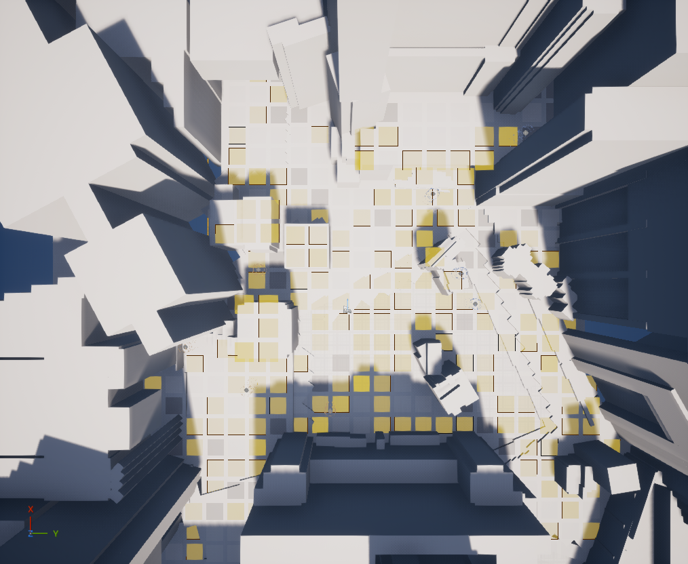
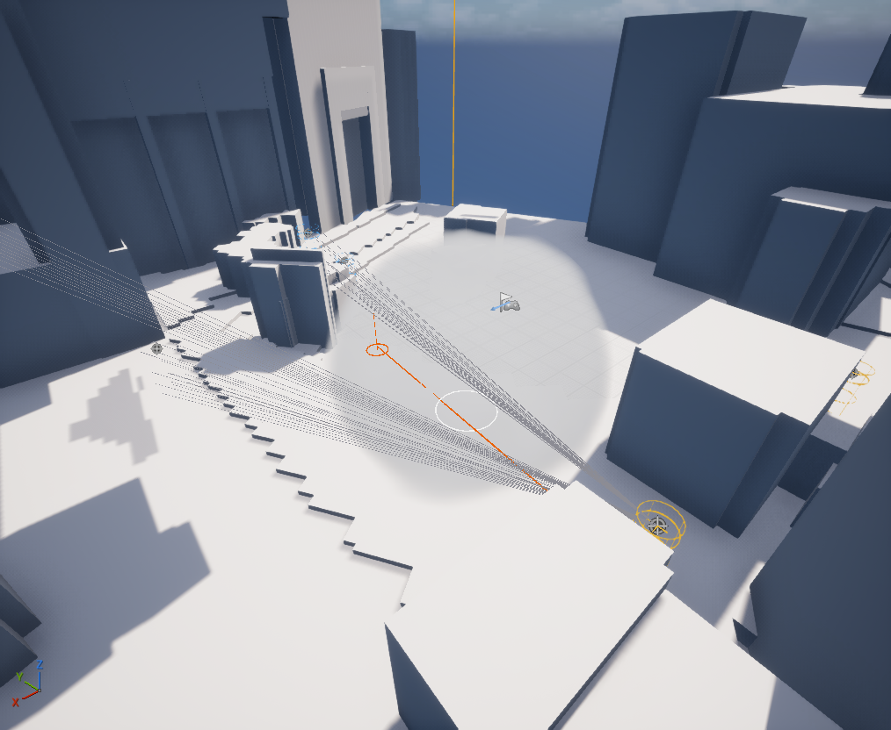

# 暴露探针 Exposure Probe

[English](README.md) | 中文

暴露探针是 Unreal Engine 5.8 的编辑器插件，用来检查竞技射击关卡里的视线。在关卡里放好 T 探针和 CT 探针，插件从每个探针的眼位向对方身体上的采样点发射线，算出双方各自能看见对方身体的多少，两者之差就是暴露不对称度 A。每次改动关卡，插件只重算受影响的射线，并列出变化的探针对，包括新出现的单向视线。

插件还有地面热力图和单向视线格子、烟雾评估（最少几个烟雾能切断视线，切断后多久能重新看见），以及版本基线和回归报告。



## 运行要求

Unreal Engine 5.8，Windows 64 位。预编译文件在 5.8.3 上编译和测试，不需要 Visual Studio，蓝图项目和 C++ 项目都能用。插件只在编辑器里工作，探针和烟雾都是仅编辑器 Actor，打包出的游戏里没有它们。

## 安装

从 [Releases](https://github.com/CAI-IP/ExposureProbe/releases) 下载 `ExposureProbe-0.3.0-UE5.8.zip`。直接克隆仓库只能拿到源码，没有预编译文件，需要自己编译（见[从源码编译](#从源码编译)）。

关闭编辑器，把压缩包里的 `Plugins` 文件夹复制到项目根目录，也就是 `.uproject` 所在的目录：

```
<你的项目>/
  <你的项目>.uproject
  Plugins/
    ExposureProbe/
      ExposureProbe.uplugin
    ExposureProbeMCP/          （可选）
```

项目原来就有 `Plugins` 文件夹的，把两个子文件夹放进去即可。打开项目后，关卡编辑器工具栏上会出现「暴露探针」按钮。如果没有，在 **编辑 → 插件** 里勾选它，再重启编辑器。

## 快速上手

任意关卡都可以，不需要示例地图。

1. 打开 **项目设置 → 插件 → 暴露探针**，在「对标游戏」里选和关卡尺度一致的预设。默认是 CS2 / Source（1 单位 = 2.54 cm，人物高 72 单位）。按 UE 默认厘米搭的关卡要选「UE 第一人称模板」或「成人 180 cm」，不然探针身体只有 72 cm 高。
2. 视口中心对准地面，点工具栏「暴露探针 → 放置 T 探针」，再换个地方点「放置 CT 探针」。放置 Actor 面板的「暴露探针」分类里也能拖出来。计算时探针会落到脚下的地面上。
3. 点「暴露探针 → 打开暴露探针面板」，再点面板上的「全量计算」。每对探针之间出现一条连线，被看见的头、躯干、腿按可见比例着色，旁边的卡片显示数值。
4. 移动一面墙或放一个箱子。松开鼠标约 0.4 秒后插件自动更新，右下角提示「本次改动影响 N 对探针，其中 M 对新增单向视线」，面板列出变化的探针对和翻转的射线。
5. 在工具栏菜单里打开「热力图（全图 A）」或「单向视线」图层。第一次打开时会先分析地面，关卡越大、采样间距越小，耗时越长。

其余功能都在工具栏菜单、面板（「窗口」菜单里也有）和插件设置里。界面语言跟随编辑器；想固定中文或英文，在插件设置「显示 → 界面语言」里选，重启编辑器后生效。

## 怎么算的

每个探针身上有 16 个采样点，4 层高度乘 4 个方位，分布在脚、膝、腰、头附近。从观察方眼位到某个点的射线没被挡住，或者第一个命中点离这个点不到 1 cm，这个点就算看得见。a(T→CT) 是 T 能看见的 CT 采样点所占比例。嵌在墙里的点不算进分母，判断方法是从身体轴线同高度向它发射线，还没到就被挡住了。

A = a(T→CT) − a(CT→T)，取值在 −1 到 1 之间。正值表示 T 看见 CT 多于 CT 看见 T。

一方能看见对方至少 50% 的采样点，而对方完全看不见这一方，这对探针就记为单向视线。阈值在「审计 → 单向视线阈值」里改。

姿态设为「自动」时，插件测探针头顶的净空：够站就站，只够蹲就蹲，蹲都不够就跳过，面板会提示。

有些单向视线是有意设计的。在探针对上点「设计保留」并写上备注，标记随关卡保存，之后的报告会把这些对单独列为预期变化。

## 单位与身体预设

「对标游戏」同时决定地图单位和人物身体，改了任何一项身体尺寸就变成「自定义」。单个探针可以在细节面板的「探针身体」里换成别的预设，方便比较不同体型。

| 预设 | 1 单位 | 身高 | 站姿眼位 | 下蹲高度 | 蹲姿眼位 | 身宽 |
|---|---|---|---|---|---|---|
| CS2 / Source | 2.54 cm | 72 | 64 | 54 | 46 | 32 |
| 使命召唤 | 2.54 cm | 72 | 60 | 52 | 40 | 32 |
| 无畏契约 | 1 cm | 180 | 166 | 140 | 126 | 68 |
| UE 第一人称模板 | 1 cm | 192 | 160 | 80 | 72 | 68 |
| 成人 180 cm | 1 cm | 180 | 167 | 135 | 120 | 80 |

尺寸都是地图单位。CS2 用的是 Valve 开发者文档里的玩家碰撞体，使命召唤取自 Radiant 关卡规范。无畏契约没有官方数据，表里是社区估计值。UE 第一人称模板取自模板角色的胶囊体和眼位。

采样默认 16 点（4 × 4），也可以改成 64 点（8 × 8），或者自己设各层高度和方位数，点越多算得越久。

## 地面分析

「分析地面」会在可站立的地面上按网格取样（默认间距 64 单位），把每个采样点当作一个人。热力图显示每处的 A：它在 1000 单位内能看见其他位置的平均比例，减去被其他位置看见的平均比例。互相都看不见的位置不算。蓝色表示看见别处多于被看见，红色相反。

单向视线图层用黄色标出这样的格子：它看得见某些位置，那些位置看不见它。选中探针后，格子改为显示和这些探针的关系，黄色格子单向看见选中的探针，深色格子被选中的探针单向看见。选了保存过地面分析的基线后，热力图还能切换成相对基线的 ΔA。

关卡有导航网格时，只在导航网格上、从探针或玩家出生点能走到或跳上的地面取样，「最大攀爬高度」默认约为身高的 0.89 倍。没有导航网格时，所有能站的表面都会被分析，包括走不到的台面，面板会提示。




## 烟雾

烟雾按球体计算，球心在落点上方，半径和持续时间取自所选游戏：

| 尺寸预设 | 半径 | 球心高度 | 持续时间 |
|---|---|---|---|
| CS2 烟雾弹 | 144 单位（365.8 cm） | 60 单位 | 22.06 s |
| 无畏契约 Brimstone | 410 cm | 171 cm | 19.25 s |
| 无畏契约 Omen | 400 cm | 167 cm | 15 s |
| 无畏契约 Astra | 475 cm | 198 cm | 14.25 s |

无畏契约没有公布球心高度，表里按 CS2 的比例（60 / 144）推算。

工具栏菜单或面板上的「放置烟雾」会把烟雾放在视口中心所指的位置，也可以从放置 Actor 面板拖入「烟雾」。分析过地面后，烟雾会吸附到最近的地面格子，拖动或按 Alt 拖动复制后会重新吸附。每个烟雾的细节面板里有「烟雾尺寸」，可以选「统一」（用插件设置里的尺寸）、某个游戏的预设或自定义。

放置的烟雾会挡住探针射线。选中探针后拖动烟雾，连线、身体着色和 A 会跟着变；松手后，改动报告把这个烟雾当作一次关卡改动。地面图层只按静态几何计算，不受烟雾影响。

选中探针后：「评估已放置的烟雾」显示已放置的烟雾挡住了它看向对方的视线的多少、每个烟雾各占多少，以及 RT。「计算烟雾方案（CC / RT）」在分析过的地面格子里找出挡住它 80% 可见视线所需的最少烟雾数，也就是 CC；用到「烟雾数上限」（默认 5）还不够时，CC 记为大于上限。「将方案转为放置的烟雾」把方案里的烟雾变成可以拖动、可以改尺寸的烟雾 Actor。

RT 是恢复时间。烟雾放下后，观察者可以等烟散，也可以走到附近另一个能重新看见的位置，取更快的那个。走过去的时间是导航路线长度除以移动速度（默认 113 单位/秒），再加 0.5 秒重新瞄准。绕行位置在观察者 2000 单位内的地面格子里找，要求隔着烟雾仍能看见原视线的 80%，而且那里的 A 不比原位置低 0.05 以上。没有导航网格时按直线距离算。没分析过地面时不找绕行位置，RT 直接取烟雾持续时间。已放置的烟雾挡住的视线不超过 20% 时，观察者仍然看得见目标，RT 记为 0。

面板里的「显示样式」（插件设置「烟雾」分类下的同名选项）只改外观，不影响计算。默认的「体积烟」是光线步进的体积，在墙面和地面处截断；第一次用时要编译材质，编译完成前先显示烟团。「烟团」由半透明球体组成，配置较低的电脑用起来更流畅。



## 基线与报告

在面板的基线栏输入版本名（比如「试玩 v3」），点「存为基线」。基线会保存探针、设置、几何指纹和计算结果，地面分析是最新的话也一起保存。每次保存关卡，插件还会自动存一份「上次保存」，并把前一份改名为「上上次保存」，不需要的话在「审计 → 保存关卡时存基线」里关掉。

在下拉框里选一个基线，面板和视口就显示相对它变化的探针对，以及新增和已消除的单向视线。当前输入和基线完全一样时，面板还会显示复现检查是否通过。

「导出报告」把相对当前基线（没选基线时相对上一次改动）的变化写成 Markdown 和 JSON 两个文件。|ΔA| 达到 0.05 的探针对算明显变化。离改动超过「远处影响距离」的探针对会单独列出，视口里用虚线从改动处连过去。

所有文件都写在项目的 `Saved/ExposureProbe/` 下：`audit_log.jsonl` 每次更新或设计保留标记记一行，`last_report.json` 是最近一次更新，另有 `Baselines/` 和 `Reports/` 两个文件夹。工具栏菜单里的「打开日志、基线与报告文件夹」可以直接打开这里。

## MCP 工具（可选）

`ExposureProbeMCP` 让 AI 助手或脚本通过 Model Context Protocol 调用插件的功能。不需要的话可以不复制这个文件夹。

在 **编辑 → 插件** 里启用 **Unreal MCP**（实验性）和 **Exposure Probe MCP Tools**，重启编辑器，Toolset Registry 会一起启用。然后在编辑器控制台输入 `ModelContextProtocol.StartServer`，服务地址是 `http://localhost:8000/mcp`。工具集名称为 `ExposureProbeMCP.ExposureProbeToolset`，参数名用小驼峰（如 `probesJson`），坐标单位是厘米。

| 工具 | 作用 |
|---|---|
| `SpawnProbes`、`ClearProbes`、`GetProbes` | 放置、删除、查询探针 |
| `FullRecompute`、`UpdateNow`、`GetLastReport`、`GetRays` | 全量计算、局部更新、读取报告和射线 |
| `MarkDesignIntent`、`ClearDesignIntent` | 设计保留标记 |
| `SetDrawMode`、`SetView`、`SetFloorFilter`、`SetAutoUpdate` | 视口显示与自动更新 |
| `GetSettings`、`SetSettings` | 读写插件设置（不写入配置文件） |
| `ComputeHeatmap`、`GetHeatmap`、`GetOneWay` | 地面分析 |
| `SaveBaseline`、`SetBaseline`、`ListBaselines`、`ExportReport` | 基线与报告 |
| `ComputeSmoke`、`GetSmoke`、`ClearSmoke`、`PlacePlanSmokes` | 烟雾方案 |
| `PlaceSmokes`、`GetPlacedSmokes`、`MoveSmoke`、`ClearPlacedSmokes`、`EvaluateSmokes` | 放置的烟雾 |

每个工具都返回 JSON 字符串，参数格式见 `Plugins/ExposureProbeMCP/Source/ExposureProbeMCP/Public/ExposureProbeToolset.h` 里的注释。

## 从源码编译

用 5.8 以外的引擎、编辑器提示模块缺失或版本不符、或者改了源码时，需要自己编译。要装 Visual Studio 2022 或更新版本并勾选「使用 C++ 的游戏开发」，项目也得是 C++ 项目；蓝图项目在编辑器里用 **工具 → 新建 C++ 类** 随便加一个类就行。删掉 `Plugins/ExposureProbe/Binaries`（用 MCP 插件的话也删掉 `Plugins/ExposureProbeMCP/Binaries`），然后编译项目的编辑器目标，或者打开 `.uproject`，在提示重新编译时选「是」。

## 常见问题

**打开项目时提示模块缺失或用其他引擎版本编译。**
预编译文件只适用于 UE 5.8 Windows 64 位，其他版本需要从源码编译。

**工具栏上没有「暴露探针」按钮。**
`ExposureProbe.uplugin` 要直接放在 `<项目>/Plugins/ExposureProbe/` 下，中间不要多一层文件夹，并且在 **编辑 → 插件** 里勾选。

**探针大得离谱或小得离谱。**
「对标游戏」和关卡尺度对不上。CS2 / Source 下人物高 72 单位，按厘米搭的 UE 关卡要改用「UE 第一人称模板」或「成人 180 cm」。

**面板提示某个探针「已跳过」。**
它头顶的空间不够下蹲。把探针挪到开阔一点的地方，或者调整身体尺寸。

**热力图铺到了屋顶这种走不上去的地方。**
关卡没有导航网格，或者关掉了「仅限可到达的地面」。加一个 Nav Mesh Bounds Volume，构建导航后重新分析地面。

**体积烟第一次显示成一团团小球。**
材质还在编译，编译完会自动切换。编译失败时日志里有 `Volume smoke material failed to compile`，烟雾会一直显示为烟团，计算不受影响。

**改了关卡却没有自动更新。**
看一下面板上的「自动」开关和插件设置里的「审计 → 改动后自动更新」。也可以随时点「立即更新」。

## 许可

MIT 许可，见 [LICENSE](LICENSE)。作者 CAI IPHONG。问题和建议请提交到 [Issues](https://github.com/CAI-IP/ExposureProbe/issues)。
